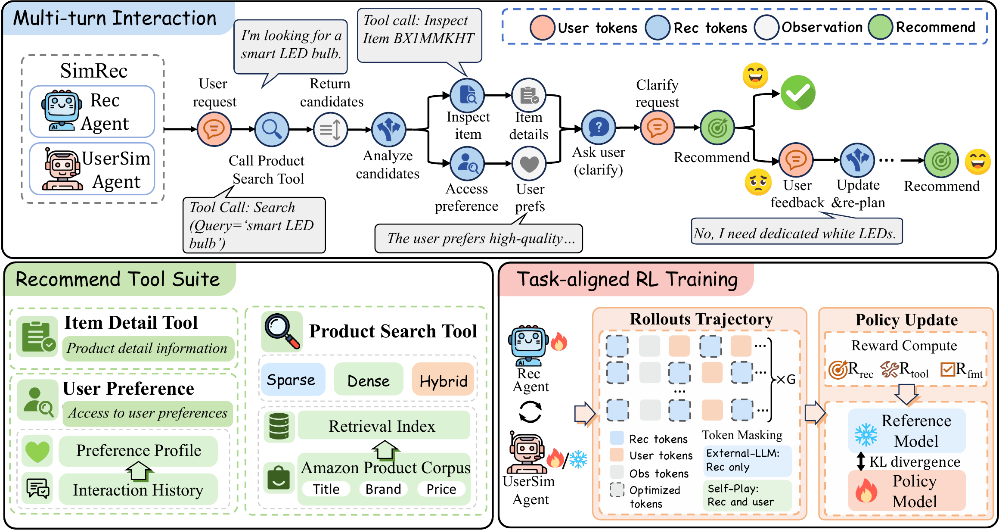

<div align="center">

# SimRec

**Learning to Search, Ask, and Recommend from Simulated Interaction**

[](pyproject.toml)
[](LICENSE)

</div>

<p align="center">
  
</p>

<p align="center"><em>
The recommendation agent interacts with a user simulator and external tools,
while task-aligned GRPO optimizes complete multi-turn trajectories.
</em></p>

Recommendation agents can retrieve products, inspect their attributes, ask a
shopper for clarification, and revise a recommendation after rejection. In many
systems, the order of these actions is a hand-written workflow. **SimRec**
trains the complete, tool-integrated interaction policy with Group Relative
Policy Optimization (GRPO). A task-anchored simulated shopper provides feedback
during the interaction, while a trajectory-level reward credits natural
retrieval, grounded tool use, and the final recommendation.

On the paper's evaluation protocol, a Qwen3-4B agent trained with SimRec raises
NDCG@100 from **32.23 to 35.42** on ESCI and from **22.94 to 24.72** on Amazon
C4. The policy learns to retrieve, inspect candidates, consult preferences when
useful, and revise after feedback; it is not given a fixed tool-use order at
inference time.

> This anonymous release contains implementation code, portable configuration
> templates, and dataset-preparation recipes. It contains no datasets, raw user
> histories, model weights, retrieval indexes, checkpoints, logs, API keys, or
> private evaluation records.

## Highlights

- **End-to-end interaction policy.** At every turn, the agent chooses between
  product search, item-detail inspection, preference access, a clarification
  question, and a final recommendation.
- **Task-anchored user simulation.** The simulator is conditioned on the
  current shopping need and dialogue, rather than the hidden target. It can be
  an external LLM or a shared-parameter self-play shopper.
- **Task-aligned trajectory reward.** GRPO jointly optimizes final Hit@1,
  natural retrieval NDCG, valid tool use, and recommendation formatting, while
  penalizing redundant queries and unnecessarily long interactions.
- **Training-only target injection.** When natural retrieval misses a target,
  a target may be inserted into the *visible* candidate list only during
  training. Natural, unmodified retrieval results always determine retrieval
  reward and evaluation metrics.

## Results

The aggregate results below are from the paper. Retrieval metrics are
instance-weighted percentages. For agents, retrieval metrics take the best
non-redundant, natural Top-100 search result in a session; Hit@1 is whether the
final recommendation belongs to the target set. Target injection is disabled in
all evaluation runs.

| Dataset | Method | NDCG@100 | Recall@100 | Hit@1 |
|---|---|---:|---:|---:|
| ESCI | Qwen3-4B Base | 32.23 | 72.03 | 21.20 |
| ESCI | ChatCRS | 34.36 | 76.80 | 22.31 |
| ESCI | **SimRec-4B** | **35.42** | **77.91** | 24.08 |
| ESCI | SimRec-4B + self-play | 34.72 | 75.81 | 22.42 |
| ESCI | SimRec-4B + BM25 | 24.02 | 65.37 | 14.76 |
| Amazon C4 | Qwen3-4B Base | 22.94 | 56.21 | 8.30 |
| Amazon C4 | ChatCRS | 22.12 | 57.96 | 7.61 |
| Amazon C4 | **SimRec-4B** | **24.72** | 59.18 | 9.75 |
| Amazon C4 | SimRec-4B + self-play | 19.77 | 49.54 | 7.14 |
| Amazon C4 | SimRec-4B + BM25 | 15.88 | 40.77 | 5.75 |

The paper also compares standalone retrievers, training-free recommenders,
trainable recommenders, and larger LLM backbones under the same agent interface.
BLAIR-LARGE has the highest Amazon C4 Recall@100 (63.01), while SimRec-4B has
the highest aggregate Amazon C4 NDCG@100 among the reported methods. Results
above use Qwen3 Dense unless the method is labelled BM25.

### Component ablations

On Amazon C4, preference access, item inspection, and feedback each contribute
to the full interaction policy. Values are percentages from the paper.

| Variant | NDCG@100 | Hit@1 |
|---|---:|---:|
| **Full SimRec** | **24.72** | **9.75** |
| without preference tool | 21.17 | 7.65 |
| without item-detail tool | 23.42 | 6.04 |
| without multi-turn feedback | 22.14 | 8.06 |

## Method

Each task contains an initial shopping request, a current task need, a target
set used only by the environment, and optionally a history-derived preference
summary. At each step, the recommender observes the dialogue and prior tool
results, then chooses one action:

| Information need | Action | Result |
|---|---|---|
| Candidate discovery | `search_products` | Ranked Top-100 catalog results; the Top-20 are visible by default. |
| Candidate verification | `get_item_details` | Full grounded metadata for a selected product. |
| Long-term preference | `get_user_preference` | A precomputed, one-sentence preference summary when available. |
| Need clarification | shopper-facing question | A direct simulator response. |
| Decision | structured recommendation | Environment success check and simulated shopper feedback. |

There is no fixed action pipeline. A recommendation can be rejected, after
which the agent may search again, inspect a candidate, consult the preference
tool, or ask a clarification question before revising its decision.

### User simulation

The shopper simulator receives the current shopping need, recent dialogue, and
latest agent action. It does **not** receive the target item ID or preference
profile. For a rejected recommendation, it replies with one or two missing
requirements without naming the target. The environment independently checks
whether the recommended item belongs to the target set.

`external` (the default) uses an OpenAI-compatible LLM endpoint. `self_play`
alternates one model between shopper and recommender roles with role-specific
prompts, so it requires no separate simulator endpoint. For Amazon C4,
histories are deduplicated, chronologically ordered, filtered to remove the
task target, and summarized once by an LLM before rollout. The runtime
preference tool sees only that precomputed sentence, never raw history.


## Quick start

Use a Python environment with a CUDA-compatible PyTorch build, then install
[verl](https://github.com/volcengine/verl) and the extra dependencies:

```bash
git clone <repository-url> SimRec
cd SimRec

pip install -r requirements.txt
git clone https://github.com/volcengine/verl.git ../verl
pip install -e .
pip install -e ../verl
export VERL_REPO_ROOT=../verl
```

The launcher expects this repository and `verl` to be sibling directories. Set
`VERL_REPO_ROOT` explicitly if your layout differs.

## Data preparation

See [`data/README.md`](data/README.md) for official ESCI and Amazon-C4 links,
the local data contract, and the full construction protocol. The repository
does not download or redistribute either source dataset.

No datasets, checkpoints, model weights, API keys, or indexes are included. Prepare JSONL records with at least:

```json
{"qid":"example-1","target_item_id":"ITEM_ID","reference_query":"I need a compact travel charger."}
```

`target_item_ids` may be used instead of `target_item_id` for multi-target evaluation. The optional `user_preference` field must be a precomputed, one-sentence LLM profile; raw purchase histories are never exposed by the runtime preference tool.

To transform an Amazon-C4-style export, run from the repository root:

```bash
python3 -m SimRec.prepare_amazon_c4 \
  --source data/raw/amazon_c4/amazon_c4.csv \
  --output_dir data/processed/amazon_c4
```

To use the preference tool, provide target-filtered history files and configure
the profile LLM only in the environment. The preparation script calls that LLM
once per task profile, records `user_profile_generator: "llm"`, and writes only
the resulting profile sentence—not the raw history—to the output JSONL.

```bash
export SIMREC_PROFILE_LLM_API_KEY=...
python3 -m SimRec.prepare_amazon_c4 \
  --source data/raw/amazon_c4/amazon_c4.csv \
  --profile_sources data/raw/amazon_c4/reviews.jsonl \
  --output_dir data/processed/amazon_c4
```

For ESCI, download an official judgement export and build qid-disjoint splits:

```bash
python3 -m SimRec.prepare_esci \
  --source data/raw/esci/judgements.csv \
  --output_dir data/processed/esci
```

The ESCI source must contain query/query ID, item ID, and an ESCI label. Exact
and Substitute labels form each task's `target_item_ids`; build the matching
catalog index separately.

The preparation command produces qid-disjoint `train.jsonl`, `validation.jsonl`,
and `test.jsonl` files with the default 90/5/5 split. Build retrieval indexes
separately and set `SEARCH_INDEX_DIR` and `SEARCH_MODEL_PATH` in your local
configuration. Input data and indexes are intentionally ignored by Git.

The repository keeps only this directory layout; add generated or downloaded
files to their matching subdirectory rather than directly under `data/`:

```text
data/
├── raw/amazon_c4/             # downloaded source exports
├── processed/amazon_c4/       # train.jsonl, validation.jsonl, test.jsonl
├── raw/esci/                  # official ESCI judgement exports
├── processed/esci/            # prepared ESCI splits
├── indexes/dense/              # dense retrieval index and metadata
├── indexes/bm25/               # BM25 retrieval index
└── profiles/                   # optional precomputed preference profiles
```

## Train

Copy the relative-path template, then place any external-simulator credential only in the shell environment:

```bash
cp configs/train.env.example configs/train.env
export SIMREC_USER_LLM_API_KEY=...
CONFIG_FILE=configs/train.env bash scripts/train_simrec.sh
```

All paths in the template are relative to the repository root. It uses two
local GPUs, Qwen3-4B, eight GRPO rollouts, Qwen3 Dense retrieval, and the
external simulator settings in the paper where those settings are portable.
Adjust data, index, model, and local GPU locations if your layout differs.

Set `SIMREC_USER_SIMULATOR_MODE=self_play` to use self-play. This changes the dataset, reward manager, interaction, tools, and agent loop together; no external user-simulator endpoint is needed.

## Held-out evaluation

Use a merged/exported checkpoint as `EVAL_MODEL_PATH`, then run the dedicated
validation-only launcher. `EVAL_DATA` defaults to `TEST_DATA` and is used
exclusively as the rollout dataset; verl constructs an inert dataset from
`VAL_DATA` but performs no optimizer step.

```bash
EVAL_MODEL_PATH=checkpoints/exported/model \
CONFIG_FILE=configs/train.env \
bash evaluation/evaluate_simrec.sh
```

Set `EVAL_DATA` only when evaluating a different held-out JSONL split. Target
injection is disabled automatically for these rollouts.


## Repository layout

| Path | Contents |
|---|---|
| [`SimRec/`](SimRec/) | Importable package: dataset adapters, agent loop, simulator, retrieval backend, GRPO reward, and data preparation commands. |
| [`SimRec/tools/`](SimRec/tools/) | External-simulator tool runtime. |
| [`SimRec/self_play/`](SimRec/self_play/) | Shared-parameter shopper/recommender rollout path. |
| [`configs/`](configs/) | Credential-free interaction, tool, and training configuration templates. |
| [`experiments/`](experiments/) | Reproducibility map for paper settings, variants, and result records. |
| [`evaluation/`](evaluation/) | Held-out evaluation launcher and protocol. |
| [`analysis/`](analysis/) | Analysis scope and result-verification protocol; generated outputs stay local. |
| [`docs/`](docs/) | Public training, evaluation, data, and release documentation. |
| [`assets/`](assets/) | Paper figures for the README when the source artwork is cleared for release. |
| [`scripts/`](scripts/) | Training launcher and small repository utilities. |
| [`tests/`](tests/) | Public smoke-test scope; no private data or run artifacts. |
| [`data/`](data/) | Tracked directory markers and expected locations for locally prepared data, indexes, and optional profiles. |


## Citation

Citation information will be added when the paper is publicly available.

## License

Apache-2.0 ([LICENSE](LICENSE)). The copyright notice uses the anonymous
collective name “SimRec Authors” during double-blind review.
